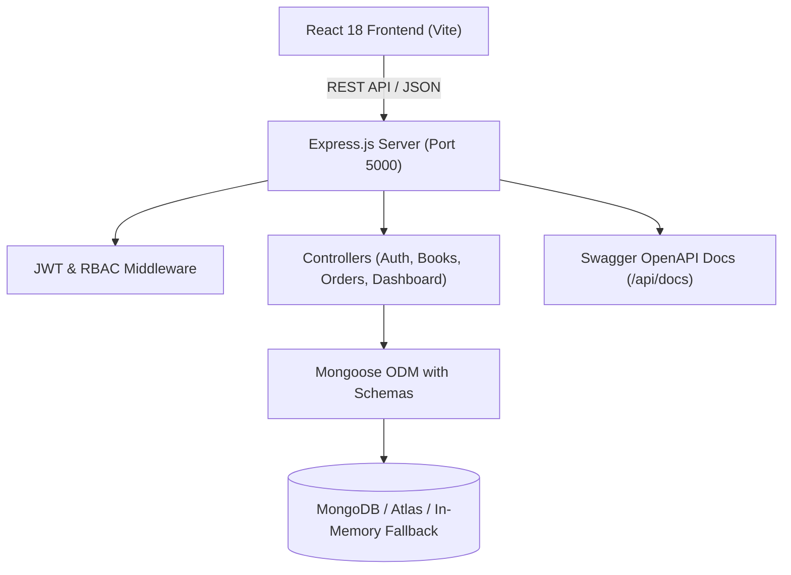

# 📚 Bookstore Management System (MERN Stack)

A modern, full-stack Bookstore Management System built with **React 18**, **Node.js**, **Express.js**, and **MongoDB**. Designed to deliver a seamless shopping experience for readers and a powerful administrative hub for bookstore owners and staff.

[](https://opensource.org/licenses/MIT)
[](https://nodejs.org/)
[](https://react.dev/)
[](https://expressjs.com/)
[](https://mongoosejs.com/)
[-success.svg)](https://jestjs.io/)

---

## 🌟 Key Features

### 👤 Customer Features
- **Featured Homepage**: Hero banner with live search, book highlights, popular category navigation, and value propositions.
- **Search & Multi-Filtering**: Full-text search across titles, authors, and descriptions; filter by genre, price range, and stock availability; sort by newest, price, or rating.
- **Detailed Book View**: High-resolution cover display, ISBN, publisher, published year, live stock indicators, quantity selector, and full synopsis.
- **Ratings & Reviews**: Real customer review submission with star ratings and comments.
- **Shopping Cart & Checkout**: Cart persistence (LocalStorage), dynamic quantity updates, price breakdown (subtotal, GST calculation, free shipping over ₹999), and multi-step checkout.
- **Multiple Payment Options**: Support for Credit/Debit Cards, UPI / QR, and Cash on Delivery with simulated checkout.
- **Order Tracking & Receipts**: Dedicated order confirmation and history page with status badge tracking (`Pending` ➔ `Processing` ➔ `Shipped` ➔ `Delivered`).
- **User Profile Management**: Update personal info, phone numbers, delivery addresses, and passwords.

### 🛡️ Admin Dashboard & Inventory Hub
- **Executive Metrics**: Real-time cards showing Total Revenue (from paid orders), Total Orders, Total SKUs, and Registered Customers.
- **Inventory Stock Alerts**: Automatic low-stock warnings for books with 5 or fewer copies remaining.
- **Book CRUD Operations**: Add new titles with cover previews, edit existing records, and safely remove items with **Confirmation Dialogs** to prevent accidental deletion.
- **Order Pipeline Management**: Filter orders by status, change fulfillment stages (`Pending`, `Processing`, `Shipped`, `Delivered`, `Cancelled`), and review shipping addresses.
- **Automatic Stock Adjustments**: Placing an order atomically decrements inventory; cancelling an order automatically restores book stock.

### 🔒 Security & Performance
- **Token-Based Authentication**: Secure stateless JWT tokens with expiration handling.
- **Password Protection**: Multi-round `bcryptjs` password hashing and salted digests.
- **Role-Based Access Control (RBAC)**: Secure middleware restricting administrative endpoints to authorized admins.
- **Centralized Error Middleware**: Structured HTTP responses for 400, 401, 403, 404, and 500 error scenarios.
- **Database Indexing**: Compound and text indexes on titles, authors, genres, and user relations.
- **Zero-Setup Database Fallback**: Built-in `mongodb-memory-server` automatic fallback if local MongoDB service is not started.

---

## 🏗️ Project Architecture & Tech Stack



### Frontend
- **Framework**: React 18 with Vite
- **Routing**: React Router DOM v6
- **State Management**: React Context API (`AuthContext`, `CartContext`, `NotificationContext`)
- **HTTP Client**: Axios with request/response interceptors
- **Icons & Styling**: Lucide React + Custom Responsive CSS Design System

### Backend
- **Runtime**: Node.js v24 / v20
- **Framework**: Express.js
- **Database**: MongoDB with Mongoose ODM
- **Security**: JWT (`jsonwebtoken`), `bcryptjs`, `helmet`, `cors`
- **Documentation**: Swagger UI (`swagger-ui-express`) + OpenAPI 3.0 spec + Postman Collection
- **Testing**: Jest + Supertest (14 passing automated tests)

---

## 📁 Repository Structure

```text
Bookstore-Management-System/
├── backend/
│   ├── src/
│   │   ├── config/
│   │   │   ├── db.js             # Mongoose connection & in-memory fallback
│   │   │   └── swagger.js        # Swagger OpenAPI configuration
│   │   ├── controllers/
│   │   │   ├── authController.js       # Register, login, profile, user list
│   │   │   ├── bookController.js       # Book CRUD, filters, reviews
│   │   │   ├── orderController.js      # Order placement, payments, status
│   │   │   └── dashboardController.js  # Admin telemetry & metrics
│   │   ├── data/
│   │   │   ├── sampleBooks.js    # Rich catalog of 12+ real-world titles
│   │   │   └── sampleUsers.js    # Seed admin and customer accounts
│   │   ├── middleware/
│   │   │   ├── authMiddleware.js # JWT protect & admin RBAC verification
│   │   │   └── errorMiddleware.js# 404 & Centralized error handler
│   │   ├── models/
│   │   │   ├── User.js           # User schema with bcrypt hooks
│   │   │   ├── Book.js           # Book schema with reviews & indexes
│   │   │   └── Order.js          # Order schema with items & status
│   │   ├── routes/
│   │   │   ├── authRoutes.js     # /api/auth and direct /api/register
│   │   │   ├── bookRoutes.js     # /api/books endpoints
│   │   │   ├── orderRoutes.js    # /api/orders endpoints
│   │   │   └── dashboardRoutes.js# /api/dashboard/stats
│   │   ├── tests/
│   │   │   ├── setup.js          # MongoMemoryServer test harness
│   │   │   ├── auth.test.js      # Auth & profile test suite
│   │   │   ├── books.test.js     # Books CRUD & reviews test suite
│   │   │   └── orders.test.js    # Orders & stock decrement test suite
│   │   ├── seeder.js             # CLI database population tool
│   │   └── server.js             # Main server bootstrap
│   ├── bookstore-api.postman_collection.json # Complete Postman collection
│   ├── .env.example
│   └── package.json
├── frontend/
│   ├── src/
│   │   ├── api/
│   │   │   └── axiosClient.js    # Axios with JWT interceptor & auto-redirect
│   │   ├── components/
│   │   │   ├── admin/
│   │   │   │   └── BookFormModal.jsx
│   │   │   ├── books/
│   │   │   │   ├── BookCard.jsx
│   │   │   │   ├── BookFilter.jsx
│   │   │   │   └── ReviewSection.jsx
│   │   │   └── common/
│   │   │       ├── Footer.jsx
│   │   │       ├── Modal.jsx     # Delete confirmation dialog
│   │   │       ├── Navbar.jsx
│   │   │       ├── Pagination.jsx
│   │   │       ├── ProtectedRoute.jsx # RBAC route guard
│   │   │       ├── Rating.jsx
│   │   │       ├── Spinner.jsx
│   │   │       └── Toast.jsx
│   │   ├── context/
│   │   │   ├── AuthContext.jsx
│   │   │   ├── CartContext.jsx
│   │   │   └── NotificationContext.jsx
│   │   ├── pages/
│   │   │   ├── admin/
│   │   │   │   ├── AdminBooksPage.jsx
│   │   │   │   ├── AdminDashboardPage.jsx
│   │   │   │   └── AdminOrdersPage.jsx
│   │   │   ├── BookDetailPage.jsx
│   │   │   ├── BookListPage.jsx
│   │   │   ├── CartPage.jsx
│   │   │   ├── CheckoutPage.jsx
│   │   │   ├── HomePage.jsx
│   │   │   ├── LoginPage.jsx     # Includes 1-click demo login buttons
│   │   │   ├── MyOrdersPage.jsx
│   │   │   ├── OrderDetailsPage.jsx
│   │   │   ├── ProfilePage.jsx
│   │   │   └── RegisterPage.jsx
│   │   ├── styles/
│   │   │   └── index.css         # Modern design system & utilities
│   │   ├── App.jsx
│   │   └── main.jsx
│   ├── index.html
│   ├── vite.config.js
│   └── package.json
├── package.json                  # Root concurrency script
└── README.md
```

---

## ⚡ Quick Start Guide

### 1. Clone the Repository
```bash
git clone https://github.com/irshad017/Bookstore-Management-System.git
cd Bookstore-Management-System
```

### 2. Install Dependencies
Run the install command from root:
```bash
npm run install:all
```
*(Or install inside `backend` and `frontend` folders individually with `npm install`)*

### 3. Configure Environment Variables
Inside `backend/.env` (or copy from `.env.example`):
```env
PORT=5000
MONGO_URI=mongodb://localhost:27017/bookstore
JWT_SECRET=supersecretjwtkey_bookstore_2026_secure
JWT_EXPIRE=30d
CLIENT_URL=http://localhost:5173
```
> **Tip**: If you do not have local MongoDB installed, no problem! The backend automatically spins up an in-memory database instance in development mode!

### 4. Seed the Database
Populate sample books, reviews, and test users:
```bash
npm run seed
```

### 5. Launch the Application
Run both frontend and backend concurrently with a single command:
```bash
npm run dev
```

- **Frontend Application**: `http://localhost:5173`
- **Backend API**: `http://localhost:5000`
- **Interactive Swagger Docs**: `http://localhost:5000/api/docs`

---

## 🔑 Pre-Configured Demo Credentials

The Login screen features **1-click quick-fill buttons** for testing both roles:

| Role | Email | Password | Privileges |
| :--- | :--- | :--- | :--- |
| **Administrator** | `admin@example.com` | `admin123Password!` | Full CRUD on books, order fulfillment pipeline, sales metrics |
| **Customer** | `john@example.com` | `password123` | Book browsing, shopping cart, checkout, reviews, order history |

---

## 📡 RESTful API Reference

All protected endpoints require `Authorization: Bearer <token>`.

### Authentication & Users
| Method | Endpoint | Access | Description |
| :--- | :--- | :--- | :--- |
| `POST` | `/api/register` or `/api/auth/register` | Public | Register new customer account |
| `POST` | `/api/login` or `/api/auth/login` | Public | Authenticate user & receive JWT token |
| `GET` | `/api/auth/profile` | Private | Retrieve authenticated user profile |
| `PUT` | `/api/auth/profile` | Private | Update user details, address, or password |
| `GET` | `/api/auth/users` | Admin | List all registered users |

### Books Catalog
| Method | Endpoint | Access | Description |
| :--- | :--- | :--- | :--- |
| `GET` | `/api/books` | Public | Get books with search, genre, sort & pagination |
| `GET` | `/api/books/featured` | Public | Retrieve curated featured books |
| `GET` | `/api/books/genres` | Public | Retrieve list of all unique genres |
| `GET` | `/api/books/:id` | Public | Get single book details and customer reviews |
| `POST` | `/api/books` | Admin | Create a new book listing |
| `PUT` | `/api/books/:id` | Admin | Update book price, stock, description |
| `DELETE` | `/api/books/:id` | Admin | Delete book from catalog |
| `POST` | `/api/books/:id/reviews` | Private | Submit star rating (1-5) and written review |

### Orders & Checkout
| Method | Endpoint | Access | Description |
| :--- | :--- | :--- | :--- |
| `POST` | `/api/orders` | Private | Place new order & decrement book stock |
| `GET` | `/api/orders/myorders` | Private | Retrieve logged-in customer's order history |
| `GET` | `/api/orders/:id` | Private | Get complete order invoice / status |
| `GET` | `/api/orders` | Admin | List all orders with status filter & pagination |
| `PUT` | `/api/orders/:id/status` | Admin | Update status (`Pending`, `Processing`, `Shipped`, `Delivered`, `Cancelled`) |
| `PUT` | `/api/orders/:id/pay` | Private | Simulate instant payment completion |

### Admin Analytics
| Method | Endpoint | Access | Description |
| :--- | :--- | :--- | :--- |
| `GET` | `/api/dashboard/stats` | Admin | Get revenue, order counts, and low-stock alerts |

---

## 🧪 Automated Testing

The backend includes a comprehensive Jest and Supertest suite:
```bash
npm test
```

### Test Coverage Highlights:
- ✅ **Authentication**: Customer registration, duplicate email rejection, login validation, and profile retrieval with JWT.
- ✅ **Book Management**: Pagination, genre filtering, admin-only book creation, RBAC rejection for non-admins, and review submissions.
- ✅ **Order Fulfillment**: Atomic stock decrement on order creation, out-of-stock rejection, and admin status updates.

```text
PASS src/tests/orders.test.js
PASS src/tests/books.test.js
PASS src/tests/auth.test.js

Test Suites: 3 passed, 3 total
Tests:       14 passed, 14 total
```

---

## 🚀 Deployment Guide

### Frontend Deployment (Vercel)
1. Push this repository to GitHub.
2. In the [Vercel Dashboard](https://vercel.com/), select **Add New Project** and import the repository.
3. Configure the Root Directory as `frontend`.
4. Set Build Command to `npm run build` and Output Directory to `dist`.
5. Add Environment Variable:
   - `VITE_API_URL`: URL of your deployed backend (e.g. `https://your-api.onrender.com/api`).
6. Deploy!

### Backend Deployment (Render)
1. In the [Render Dashboard](https://render.com/), choose **New Web Service** and link your repo.
2. Set Root Directory to `backend`.
3. Set Build Command to `npm install`.
4. Set Start Command to `node src/server.js`.
5. Add Environment Variables:
   - `NODE_ENV`: `production`
   - `PORT`: `5000`
   - `MONGO_URI`: Your MongoDB Atlas connection string.
   - `JWT_SECRET`: A secure random secret string.
   - `CLIENT_URL`: URL of your deployed frontend.
6. Deploy!

---

## 📄 License
This project is open-source and available under the [MIT License](LICENSE).
Developed with ❤️ by **Irshad Hussain** for the Bookstore Management System project.
